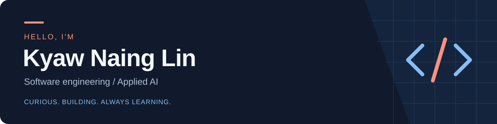

  

  <b>Computer Science student · Rangsit University · Bangkok, Thailand</b> 
  Building practical applications and growing my programming foundations.

  
  

### A little about me

- **Interested in:** software engineering, Python/backend development, and applied AI.
- **Open to:** junior and internship opportunities, including remote roles.
- **Learning through:** real projects, research, testing, and debugging.

### Things I've built

<table>
<tr>
<td width="33%" valign="top">
<h3>SafeDrive BKK</h3>

Explore Bangkok accident hotspots and compare route risk using historical data.

<b>Top 10 finalist</b> · RSU ICT Hackathon Research + application development

Python · Flask · pandas · ML · Docker

<a href="https://github.com/HarryLynn-afk/SafeDriveBKK"><b>Explore the code →</b></a>

</td>
<td width="33%" valign="top">
<h3>NOONA</h3>

English/Burmese restaurant ordering, from menu customization to real-time order tracking.

Server-controlled pricing, customer/staff access rules, and automated tests.

React · JavaScript · Firebase · Vitest

<a href="https://github.com/HarryLynn-afk/Restaurant-Ordering-MVP"><b>Code →</b></a> &nbsp; <a href="https://restaurant-ordering-app-1addc.web.app"><b>Demo →</b></a>

</td>
<td width="33%" valign="top">
<h3>NihonGo</h3>

Spoken Japanese interview practice with live captions and transcript-based AI feedback.

<b>In development</b> · university project Research evaluation pending

Next.js · TypeScript · Supabase · Groq

<a href="https://github.com/HarryLynn-afk/nihongo-mock-interview"><b>Code →</b></a> &nbsp; <a href="https://nihongointerview.netlify.app"><b>Desktop preview →</b></a>

</td>
</tr>
</table>

NOONA demo: use fictional details and do not make a payment. NihonGo is a preview; full production-flow verification remains pending.

### My toolbox

**Programming foundations & version control**

   &nbsp;
   &nbsp;
   &nbsp;
   &nbsp;
  

**Used in AI-assisted projects**

  
  
  
  
  
  
  

I use **Codex, Cursor Agent, Claude, and Claude Code** to turn requirements into working projects through research, task decomposition, and iterative prompting. Development is substantially AI-assisted; each project README explains my contribution and limitations.

